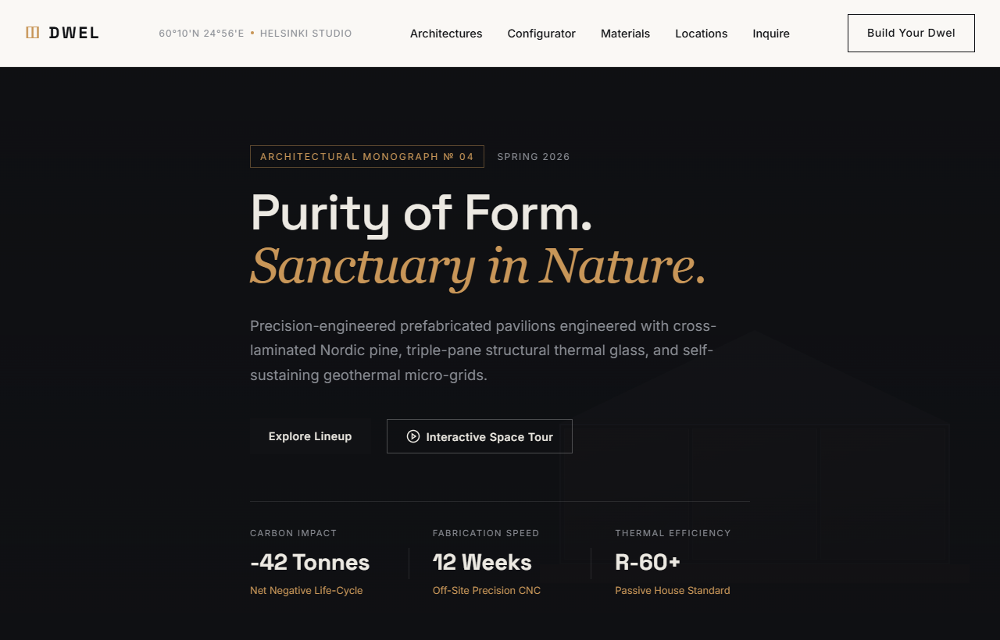

# Dwel (Toxa) — Minimalist Arxitektura & Ekologik Yashash Maskani

Dwel — Skandinaviya minimalizmi, tabiat bilan uyg'unlashgan modulli arxitektura va uglerod-manfiy (carbon-negative) prefab uylar yaratishga ixtisoslashgan me'moriy platformaning veb-interfeysi (UI).

---

## 📸 Veb-Sahifa Ko'rinishi (Skrinshot)

---

## 🌟 Asosiy Imkoniyatlar va Funksiyalar

1. **Skandinaviya Minimalistik Dizayn Tizimi**:
   - Qora obsidian (`#0f1013`), travertin toshi (`#f5f2eb`) va oqsoqol bronza-amber aksenti.
   - `Space Grotesk` va `Inter` shriftlari uyg'unligi orqali mualliflik monografiyasi darajasidagi tozalik.

2. **Interaktiv "Build Your Dwel" Xonadon Konfiguratori**:
   - 3 xil arxitektura modeli (Cabin 45m², Pavilion 95m², Villa 190m²).
   - Tashqi qoplama (Kuygan Shou Sugi Ban archasi, Sibir tilog'ochi, qora rux panellar).
   - Mustaqil energiya manbalari (Tesla Powerwall quyosh tomi, geotermal isitish).
   - Ichki bezak turlari bo'yicha lahzalik investitsiya narxi va yetkazib berish muddatini hisoblab beruvchi kalkulyator.

3. **Fazoviy 3D Reja Ko'ruvchisi (Spatial Floor Plan Modal)**:
   - Birinchi qavat (Ground Level) va tom ustidagi ochiq quyosh terrasi (Roof Sun Terrace) o'rtasida interaktiv almashish.

4. **Ekologik Materiallar Falsafasi (Material Philosophy)**:
   - Qayta tiklanadigan yog'och (CLT), uch qavatli argonli oynaband devorlar va poydevor vintlari bilan tabiatga zarar yetkazmaslik konsepsiyasi.

5. **Xalqaro Loyihalar Arxiv Galereyasi**:
   - Islandiya (Tingvellir vodiysi), Shveytsariya (Grindelvald) va Yaponiya (Xokkaydo, Niseko) tog'laridagi tayyor obyektlar katalogi.

---

## 🛠 Texnologiyalar Steki

- **HTML5**: Semantik, qat'iy me'moriy grid tuzilmasi.
- **CSS3 (Vanilla)**: Modulli Flexbox, CSS Grid, adaptiv tipografiya.
- **JavaScript (ES6+)**: Konfigurator hisob-kitob mantiqi, segmentli selektorlar, modal reja almashtirgich.
- **Shriftlar**: Google Fonts (Space Grotesk, Inter).

---

## 🔗 Havolalar

- **GitHub Repositoriyasi**: [https://github.com/qodirovtoirbektts-jpg/toxa-dwel](https://github.com/qodirovtoirbektts-jpg/toxa-dwel)
- **Jonli Veb-Sahifa (Live Demo)**: [https://qodirovtoirbektts-jpg.github.io/toxa-dwel/](https://qodirovtoirbektts-jpg.github.io/toxa-dwel/)

---

### 👨‍💻 Muallif
**Toxa (qodirovtoirbektts-jpg)**
